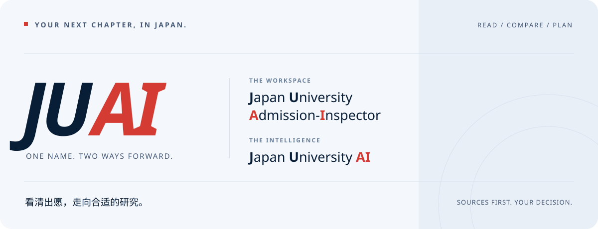

  <a href="README.md">简体中文</a> · <strong>English</strong> · <a href="README.ja.md">日本語</a>

  

<h1 align="center">JUAI · Understand admissions. Find research that fits.</h1>

  <strong>Japan University Admission-Inspector</strong> 
  Also <strong>Japan University AI</strong>. 
  Read the requirements, organize your choices, and plan your next step toward graduate study in Japan.

  <a href="https://gotojuai.online"><strong>Open the online workspace</strong></a> ·
  <a href="https://github.com/Aka1H1gash1/JUAI-Japanese-University-Admission-Inspector/releases">Download the local edition</a> ·
  <a href="#usage">Usage</a> ·
  <a href="#running-from-source">Development</a>

  
  
  
  

## One name, two meanings

**J**apan **U**niversity **A**dmission-**I**nspector keeps admissions information from university websites, application guidelines, and emails traceable to its sources. 
**J**apan **U**niversity **AI** helps you find sources, read documents, and extract requirements for your review and decisions.

JUAI is a workspace for students applying to master's and doctoral programs in Japan. From your first university of interest to specific laboratories, faculty members, and application rounds, it brings school research, documents, past exam papers, correspondence, application materials, and tasks together.

## Human-in-the-loop: people drive the system

**You are the system's core driver.** You define your goals, initiate tasks, review sources and AI output, make corrections, choose what to save, and decide the next step. AI assists with searching, reading, extracting, and organizing information; application decisions and progress remain under your control. Email drafts are reviewed and sent by you, never automatically by JUAI.

**You set the goal → AI finds and organizes information → You review and revise → You confirm what to save → You decide what happens next.**

> **AI helps organize; you make the decisions.** Admissions requirements, documents, and dates should be checked against the university's latest official materials. AI drafts enter your records after your review and confirmation.

## From “where should I apply?” to “what should I do next?”

| What you are working on | How JUAI helps |
| --- | --- |
| **Finding a suitable research direction** | Build records from university → graduate school → program → laboratory → faculty member. Search research areas, mark application targets, compare options, and track costs and budgets. |
| **Understanding websites and application guidelines** | Start analysis from a URL or file, retain sources and original documents, and review AI-extracted materials, exam subjects, dates, and special requirements. Official web search helps discover additional sources. |
| **Organizing files by year** | Filter files by university, graduate school, program, year, and type. Archive application guidelines, past papers, answers, supplementary files, and research papers. |
| **Reading and building your knowledge** | Read PDFs within the workspace, search, zoom, annotate, and take notes. Document AI Q&A helps locate passages while retaining citations you can revisit. |
| **Learning from previous applicants** | Browse an application experience section by university, with posts across its graduate schools and programs. Cards show sources, years, and summaries; filter, add posts manually, or review search results before saving. |
| **Preparing for faculty contact and entrance exams** | The Exam Roadmap (修考之路) gathers target laboratories. The faculty contact board preserves separate contact histories, while past papers and corresponding answers are organized by affiliation and year. |
| **Turning plans into dates** | Manage materials and tasks separately, with reviewed imports and manual entries. Use the application overview, calendar, and timeline to organize upcoming work, with Excel and calendar exports. |

**Find things even as your collection grows.** University, graduate school, program, laboratory, faculty, roadmap, and file lists support 12, 24, or 48 items per page. Search covers the full dataset. Use <code>⌘K</code> or <code>Ctrl+K</code> to jump directly to a record.

<strong>A glimpse of the interface · Light and dark welcome screens</strong>

<picture>
  <source media="(prefers-color-scheme: dark)" srcset="design/screenshots/welcome-desktop-dark.png" />
  
</picture>

The interface supports desktop and mobile layouts. This preview shows the welcome screen; available features depend on the version you use.

## Usage

### Online edition · Continue across devices

Open **[gotojuai.online](https://gotojuai.online)**, register, and verify your email to enter your personal workspace. The online edition includes sign-in, email-based password recovery, an individual data space, and file management. Your data is stored on the server, and the website is also accessible from a phone.

Configure your own model API to use AI features. Public pages can be read by the server. For pages that require your everyday Chrome login session, download and pair the connector from the device page so that your authorized computer can read them.

> The connector has been verified on **macOS Apple Silicon with Chrome 144 or later**. Mobile browsers can access the workspace; collection using a logged-in browser requires the authorized computer to remain online. The Mac package is not notarized, so first launch may require manual approval in System Settings. Windows and Intel Mac connectors have not completed delivery validation.

### Local edition · Keep your data on your computer

Visit **[GitHub Releases](https://github.com/Aka1H1gash1/JUAI-Japanese-University-Admission-Inspector/releases)** and choose a portable ZIP for your platform. Local browser editions are available for Windows x64, macOS Apple Silicon, and macOS Intel; check each release's support notes.

1. Extract the package and double-click **JUAI**.
2. The launcher starts the bundled data service and opens the workspace, preferring an existing Chrome installation.
3. Add universities or laboratories, upload documents, and start organizing.

No separate installation of Node.js, pnpm, Electron, or a database is required. The default data directory is <code>~/Documents/JapanGradWorkspace</code>, separate from browser caches and the application directory. Create backups under “Settings → Local workspace”; see the [user guide (Chinese)](local-server/USER_GUIDE.md) for restoration steps.

The local edition can temporarily enable phone access over the same Wi-Fi network. This and the online edition are separate ways to use JUAI; **they do not synchronize automatically**.

| | Online edition | Local browser edition |
| --- | --- | --- |
| Data location | Personal space on the server | Workspace on your computer |
| Access across devices | Sign in to the website | Optionally enable LAN access while the computer is running |
| AI integration | Your own API; Chrome connector support | Your own API and locally available Codex / Agent integrations |
| Everyday use | A browser; a connector for logged-in page collection | Double-click the launcher and use the bundled runtime |

The online edition and local packages have separate versions. Repository source code may contain features newer than the published local ZIPs. See the [v1.3 local release notes (Chinese)](browser/RELEASE_NOTES.md).

## Your own entrance exam roadmap

1. **Choose targets:** Organize universities, graduate schools, and programs, then record laboratories and faculty members of interest.
2. **Read the sources:** Analyze websites and application guidelines, reviewing materials, subjects, eligibility, and dates item by item.
3. **Keep your documents:** Archive files by year and retain your notes on past exams and research papers.
4. **Plan the next step:** Add laboratories to the roadmap, manage correspondence, prepare materials, and schedule tasks with deadlines.
5. **Compare and reflect:** Compare research directions, exam schedules, and budgets. Export Excel or calendar files and adjust your choices as you learn more.

## AI and source handling

- Official search, page reading, PDF reading, and draft review form a connected workflow. Search snippets are not used directly as evidence for saved fields.
- When adding lower-level records, analysis links to existing parent records first. Updates stay within the selected entity's scope; laboratory imports can optionally include identified faculty members in charge.
- Scanned documents require OCR or image recognition and may contain recognition errors. Check course tables, exemption conditions, and dates against the originals.
- DeepSeek's official search has been verified with real calls. OpenAI native search integration has contract tests, but has not completed acceptance testing with a real OpenAI key. Availability depends on the model, account, and provider.
- AI configuration and permissions differ between the online and local editions. Local Codex, STDIO MCP, and other on-device capabilities are not exposed as arbitrary execution endpoints on the public server.

## Running from source

Use **Node.js 24** and the **pnpm** version specified by the project.

~~~sh
git clone https://github.com/Aka1H1gash1/JUAI-Japanese-University-Admission-Inspector.git
cd JUAI-Japanese-University-Admission-Inspector
pnpm install
pnpm setup:japangrad-server
~~~

For development, use two terminals:

~~~sh
# Terminal 1: local data service
pnpm dev:japangrad

# Terminal 2: frontend
pnpm --filter @vben/web-antd dev --host 127.0.0.1 --port 5666
~~~

Open <code>http://127.0.0.1:5666/japan-grad/overview</code>.

Build and run the local browser edition:

~~~sh
pnpm build:japangrad
pnpm start:browser
~~~

This public repository maintains the complete local product and shared business core. Accounts, administration, and deployment for the online platform are maintained in a separate server repository. Running this repository does not provide the online platform's account system.

<strong>Project structure and further documentation</strong>

~~~text
apps/web-antd/       Vue interface, business pages, and brand assets
browser/            Browser launcher, portable packages, and release checks
local-server/       Local APIs, SQLite, files, and analysis services
packages/           Shared components and framework capabilities
internal/           Build, type, and code quality tooling
docs/japangrad/     Product requirements and development records
docs/assets/        README brand banner
design/             Design records and interface previews
LICENSES/           Third-party license notices
~~~

The following documents are in Chinese:

- [User guide](local-server/USER_GUIDE.md)
- [Development and data notes](apps/web-antd/src/views/japan-grad/README.md)
- [Local browser release notes](browser/RELEASE_NOTES.md)
- [Product requirements](docs/japangrad/PRD.md)
- [Design records](design/REDESIGN.md)

## Technology and open source

Vue 3 · TypeScript · Ant Design Vue · Vite · Node.js · SQLite.

JUAI is built on [Vue Vben Admin](https://github.com/vbenjs/vue-vben-admin) and uses the [MIT License](LICENSE). Its shared framework and components build on that project; see [LICENSES/Vue-Vben-Admin.txt](LICENSES/Vue-Vben-Admin.txt) for third-party notices.

<strong>JUAI</strong> Bring each application closer to the research you want to pursue.

## Faculty and laboratory overview, stage-specific exports

The dedicated faculty / laboratory view offers cards and compact rows for browsing universities, research areas, international student information, language requirements, and contact stages. The broader list includes all recorded laboratories; targets are those marked as places you want to apply to. More detailed filters for university, graduate school, contact stage, international student information, and language keywords are available in the Exam Roadmap. Unverified student composition remains unconfirmed; nationality is not inferred from names. Record sources and notes when editing a laboratory.

University, laboratory overview, and target laboratory lists support Excel and PDF export. Choose overview, stage-specific, or detailed exports, using the primary faculty contact's stage or selecting a purpose manually: school research, correspondence, interviews, applications, or reviewing results. Custom-field Excel exports remain available. PDFs are generated in the browser with embedded Chinese and Japanese fonts and A4 pagination; export contents are not uploaded to third parties.

The PDF font is a static TrueType font at weight 400, instantiated from the variable [Google Fonts Noto Sans SC](https://github.com/google/fonts/tree/main/ofl/notosanssc) font. See its [OFL license](apps/web-antd/public/fonts/OFL.txt). It loads on demand and is embedded in full for reader compatibility, so exported PDFs may start at around 6 MB.
