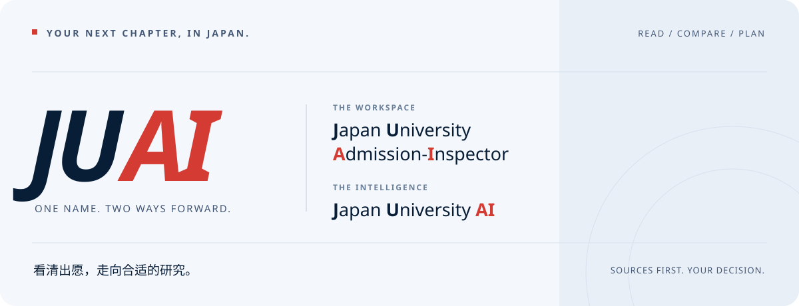
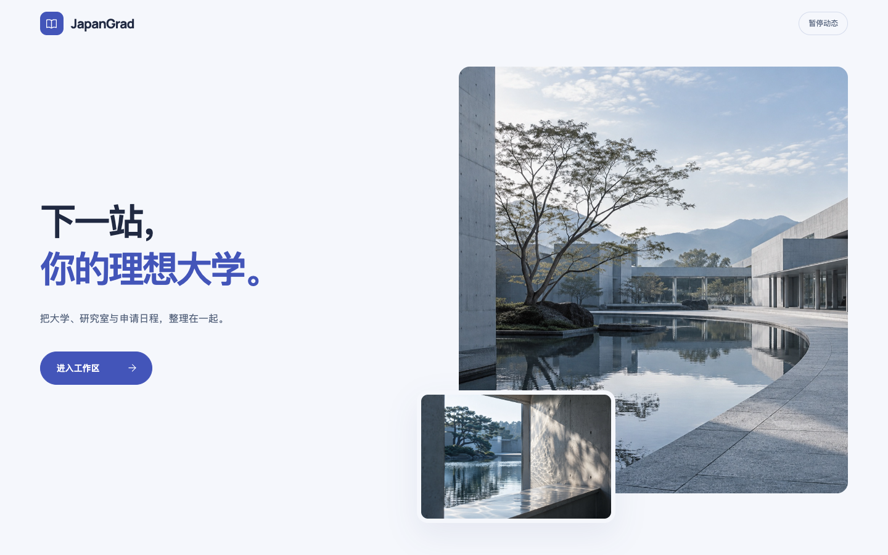

  <a href="README.md">简体中文</a> · <a href="README.en.md">English</a> · <strong>日本語</strong>

  

<h1 align="center">JUAI · 募集要項を読み解き、自分に合う研究へ。</h1>

  <strong>Japan University Admission-Inspector</strong> 
  そして、<strong>Japan University AI</strong>。 
  日本の大学院への出願に向けて、情報を理解し、選択肢を整理し、次の行動を予定に落とし込む。

  <a href="https://gotojuai.online"><strong>オンライン版を開く</strong></a> ·
  <a href="https://github.com/Aka1H1gash1/JUAI-Japanese-University-Admission-Inspector/releases">ローカル版をダウンロード</a> ·
  <a href="#使い方">使い方</a> ·
  <a href="#ソースコードから実行">開発者向け情報</a>

  
  
  
  

## 一つの名前に、二つの意味

**J**apan **U**niversity **A**dmission-**I**nspector。大学の公式サイト、募集要項、メールに分散した出願情報を、出典とともに確認できるようにします。 
**J**apan **U**niversity **AI**。AIが情報源の探索、資料の読解、要件の抽出を手伝い、利用者が内容を確認して判断します。

JUAIは、日本の修士課程・博士課程を目指す学生のためのワークスペースです。最初に気になった大学から、具体的な研究室、教員、各回の出願まで。大学選び、資料、過去問、教員との連絡、出願書類、タスクを一か所にまとめます。

## Human-in-the-loop：人がシステムを動かす

**システムの中心で、全体を動かすのは利用者です。** 目標の設定、タスクの開始、出典とAIの出力の確認、内容の修正、保存する情報の選択、次の行動の決定を、人が担います。AIは検索、読解、抽出、整理を支援し、出願に関する判断や進捗の管理は利用者が行います。メールの草稿も利用者自身が確認して送信し、JUAIが自動送信することはありません。

**人が目標を決める → AIが情報を集めて整理する → 人が確認・修正する → 人が採用を確定する → 人が次の行動を決める。**

> **AIは整理を手伝い、判断はあなたが行う。** 募集要件、必要書類、日程は、大学の最新の公式資料で確認してください。AIの草稿は、利用者が内容を確認して確定した後に記録へ保存されます。

## 「どこを受けるか」から「次に何をするか」まで

| 取り組んでいること | JUAIのサポート |
| --- | --- |
| **自分に合う研究分野を探す** | 大学 → 研究科 → 専攻 → 研究室 → 教員の順に情報を整理。研究分野の検索、志望先の登録、比較、費用や予算の記録に対応します。 |
| **公式サイトと募集要項を読み解く** | URLやファイルから解析を開始し、出典と原本を保存。AIが抽出した書類、具体的な試験科目、日程、個別の要件を確認できます。公式ウェブ検索で情報源を追加探索できます。 |
| **年度ごとのファイルを整理する** | 大学、研究科、専攻、年、種類でファイルを絞り込み、募集要項、過去問、解答、補足資料、論文を保存できます。 |
| **読みながら知識を蓄積する** | ワークスペース内でPDFの閲覧、検索、拡大・縮小、注釈、ノートの記録ができます。文書AIへの質問で原文を探し、後から確認できる引用を残せます。 |
| **先輩の受験体験を参考にする** | 大学別の受験体験記から、各研究科・専攻の投稿をまとめて閲覧。出典、年、概要をカードで確認し、絞り込み、手動追加、検索結果の確認・登録ができます。 |
| **教員への連絡と入試を準備する** | 受験ロードマップ（修考之路）に志望研究室を集約。教員連絡ボードでは連絡履歴を分けて記録し、過去問コーナーでは所属と年ごとに問題・解答を整理できます。 |
| **行動を日程に落とし込む** | 書類の準備とタスクを分けて管理し、確認付きインポートと手動追加に対応。出願状況の概要、カレンダー、タイムラインで予定を整理し、Excelやカレンダー形式で出力できます。 |

**情報が増えても、見つけやすく。** 大学、研究科、専攻、研究室、教員、受験ロードマップ、ファイル一覧は、1ページ12・24・48件の表示に対応。検索は全データが対象です。<code>⌘K</code>／<code>Ctrl+K</code>で、目的の記録にすばやく移動できます。

<strong>画面の紹介 · ウェルカム画面のライト／ダークモード</strong>

<picture>
  <source media="(prefers-color-scheme: dark)" srcset="design/screenshots/welcome-desktop-dark.png" />
  
</picture>

パソコンとスマートフォンの画面に対応しています。ここではウェルカム画面を紹介しています。利用できる機能は各バージョンをご確認ください。

## 使い方

### オンライン版 · 複数の端末から続けられる

**[gotojuai.online](https://gotojuai.online)**で登録し、メールアドレスを認証すると、個人のワークスペースを利用できます。ログイン、メールによるパスワード再設定、利用者ごとに独立したデータ領域、ファイル管理に対応。資料はサーバーに保存され、スマートフォンからもウェブでアクセスできます。

AI機能には、自分のモデルAPIを設定します。公開ページはサーバーから取得できます。普段使っているChromeのログイン状態が必要なページは、デバイスページからコネクターをダウンロードしてペアリングし、許可したパソコンで取得します。

> コネクターは、**macOS Apple SiliconとChrome 144以降**の組み合わせで動作確認済みです。スマートフォンでもウェブ画面は使えますが、ログイン状態を使う取得には、許可したパソコンがオンラインである必要があります。Mac用パッケージは未公証のため、初回起動時にシステム設定で手動の許可が必要になる場合があります。Windows／Intel Mac用コネクターは、提供に向けた検証が完了していません。

### ローカル版 · 資料を自分のパソコンに保存する

**[GitHub Releases](https://github.com/Aka1H1gash1/JUAI-Japanese-University-Admission-Inspector/releases)**から、利用する環境のポータブルZIPを選んでください。Windows x64、macOS Apple Silicon、macOS Intel向けのローカルブラウザー版があります。対応状況は各リリースの説明をご確認ください。

1. ZIPを展開し、**JUAI**をダブルクリックします。
2. ランチャーが同梱のデータサービスを起動し、インストール済みのChromeを優先してワークスペースを開きます。
3. 大学や研究室を追加し、資料をアップロードして整理を始めます。

Node.js、pnpm、Electron、データベースを別途インストールする必要はありません。標準の保存先は<code>~/Documents/JapanGradWorkspace</code>で、ブラウザーのキャッシュやアプリ本体とは別に管理されます。「設定 → ローカルワークスペース」からバックアップでき、復元手順は[利用ガイド（中国語）](local-server/USER_GUIDE.md)に記載しています。

ローカル版では、同じWi-Fi内のスマートフォンからの一時的なアクセスを有効にできます。オンライン版とは別の利用方法で、**両者の自動同期機能はありません**。

| | オンライン版 | ローカルブラウザー版 |
| --- | --- | --- |
| データの保存先 | サーバー上の個人領域 | 自分のパソコンのワークスペース |
| 複数端末からの利用 | ウェブサイトにログイン | パソコンの起動中、必要に応じてLAN内アクセスを有効化 |
| AI連携 | 自分のAPI、Chromeコネクター | 自分のAPI、ローカルで利用できるCodex／Agentなど |
| 日常の起動 | ブラウザーで利用。ログイン状態を使う取得にはコネクターが必要 | ランチャーをダブルクリックし、同梱ランタイムで実行 |

オンライン版とローカル配布パッケージは、別々にバージョン管理しています。リポジトリのソースコードには、公開済みのローカルZIPより新しい機能が含まれる場合があります。更新内容は[v1.3ローカル版リリースノート（中国語）](browser/RELEASE_NOTES.md)をご覧ください。

## 自分の受験ロードマップを作る

1. **志望先を決める：** 大学、研究科、専攻を整理し、気になる研究室と教員を記録する。
2. **出典を読む：** 公式サイトと募集要項を解析し、必要書類、試験科目、応募条件、日程を一つずつ確認する。
3. **資料を残す：** 年ごとにファイルを保存し、過去問や論文を読んだ記録を残す。
4. **次の行動を決める：** 研究室をロードマップに追加し、教員への連絡、書類の準備、期限のあるタスクを進める。
5. **比較して振り返る：** 研究分野、試験日程、予算を比較し、Excelやカレンダーに出力しながら志望先を見直す。

## AIと情報の扱い

- 公式検索、ウェブページの取得、PDFの読解、草稿の確認を、一続きの流れとして扱います。検索結果の要約を、そのまま記録項目の根拠にはしません。
- 下位の情報を新規登録する際は、既存の上位レコードへの関連付けを優先します。更新範囲は対象の階層内とし、研究室のインポートでは、特定できた担当教員も任意で取り込めます。
- スキャン資料にはOCRや画像認識が必要で、文字の誤認識が生じる場合があります。科目の別表、試験免除の条件、日程は原本と照合してください。
- DeepSeekの公式検索は、実際のAPI呼び出しで検証済みです。OpenAIネイティブ検索の連携には契約テストがありますが、実際のOpenAIキーを使った受け入れ検証は未実施です。利用可否は、モデル、アカウント、提供元の対応状況によります。
- オンライン版とローカル版では、AI設定と権限が異なります。ローカルのCodexやSTDIO MCPなどを、公開サーバー上の任意実行機能として提供することはありません。

## ソースコードから実行

**Node.js 24**と、プロジェクト指定バージョンの**pnpm**を使用します。

~~~sh
git clone https://github.com/Aka1H1gash1/JUAI-Japanese-University-Admission-Inspector.git
cd JUAI-Japanese-University-Admission-Inspector
pnpm install
pnpm setup:japangrad-server
~~~

開発時は、二つのターミナルを使用します。

~~~sh
# ターミナル1：ローカルデータサービス
pnpm dev:japangrad

# ターミナル2：フロントエンド
pnpm --filter @vben/web-antd dev --host 127.0.0.1 --port 5666
~~~

<code>http://127.0.0.1:5666/japan-grad/overview</code>を開きます。

ローカルブラウザー版をビルドして起動する場合：

~~~sh
pnpm build:japangrad
pnpm start:browser
~~~

この公開リポジトリでは、ローカル版の製品全体と共通の業務コアを管理しています。オンライン版のアカウント、管理者機能、デプロイ部分は、別のサーバーリポジトリで管理しています。このリポジトリを起動しても、オンライン版のアカウントシステムは含まれません。

<strong>プロジェクト構成と関連ドキュメント</strong>

~~~text
apps/web-antd/       Vueの画面、業務ページ、ブランド素材
browser/            ブラウザー用ランチャー、配布パッケージ、リリース検証
local-server/       ローカルAPI、SQLite、ファイル、解析サービス
packages/           共通コンポーネントとフレームワーク機能
internal/           ビルド、型、コード品質のツール
docs/japangrad/     製品要件と開発記録
docs/assets/        README用ブランドバナー
design/             デザイン記録と画面プレビュー
LICENSES/           サードパーティーのライセンス表記
~~~

以下のドキュメントは中国語です。

- [利用ガイド](local-server/USER_GUIDE.md)
- [開発とデータに関する説明](apps/web-antd/src/views/japan-grad/README.md)
- [ローカルブラウザー版リリースノート](browser/RELEASE_NOTES.md)
- [製品要件](docs/japangrad/PRD.md)
- [デザイン記録](design/REDESIGN.md)

## 技術とオープンソース

Vue 3 · TypeScript · Ant Design Vue · Vite · Node.js · SQLite。

[Vue Vben Admin](https://github.com/vbenjs/vue-vben-admin)を基盤に開発し、[MIT License](LICENSE)を採用しています。共通フレームワークとコンポーネントは同プロジェクトの実装を利用しています。サードパーティーに関する表記は[LICENSES/Vue-Vben-Admin.txt](LICENSES/Vue-Vben-Admin.txt)をご覧ください。

<strong>JUAI</strong> 一つひとつの出願を、取り組みたい研究に近づける。

## 教員・研究室の一覧と、準備段階に応じたエクスポート

独立した「教員／研究室」画面では、カード表示とコンパクトな行表示で、大学、研究分野、留学生の状況、語学要件、連絡段階を確認できます。候補一覧には登録済みの研究室すべてが含まれ、志望先は「受験したい」とマークした研究室です。大学、研究科、連絡段階、留学生の状況、語学キーワードによる詳細な絞り込みは、受験ロードマップで行えます。学生構成が未確認の場合は、その状態を維持し、名前から国籍を推定しません。研究室の編集画面で、出典と補足を記録できます。

大学一覧、研究室の概要一覧、志望研究室は、ExcelとPDFで出力できます。概要版、準備段階別、詳細版から選び、主に連絡している教員の段階を参考にするほか、大学選び、教員への連絡、面接、出願、結果の振り返りなど、用途を手動で選択できます。項目を選ぶ従来のExcel出力も利用できます。PDFはブラウザー内で生成し、中国語・日本語フォントの埋め込みとA4のページ分割に対応しています。出力内容を第三者にアップロードしません。

PDF用フォントは、[Google Fonts Noto Sans SC](https://github.com/google/fonts/tree/main/ofl/notosanssc)の可変フォントから、ウェイト400の静的TrueTypeを生成したものです。[OFLライセンス](apps/web-antd/public/fonts/OFL.txt)をご覧ください。必要なときに読み込み、PDFリーダーとの互換性のためフォント全体を埋め込むので、PDFの容量は約6MBからになる場合があります。
