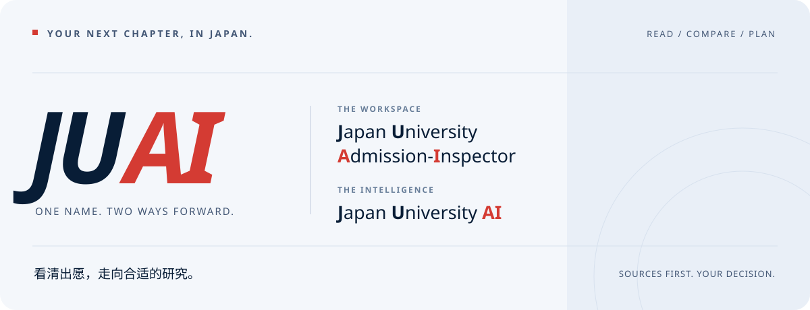
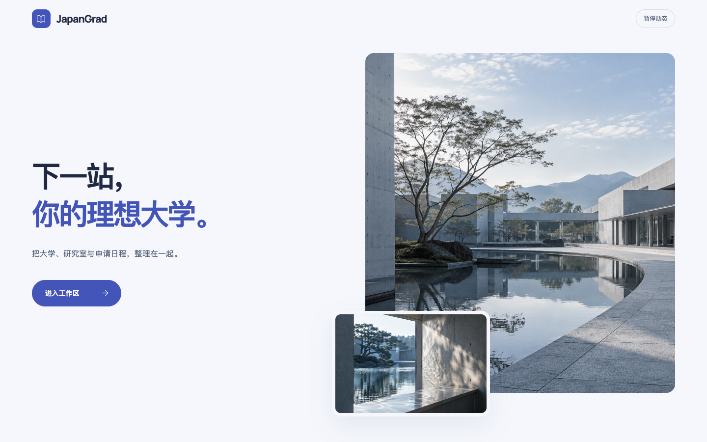

<p align="center">
  
</p>

<h1 align="center">JUAI · 看清出愿，走向合适的研究。</h1>

<p align="center">
  <strong>Japan University Admission-Inspector</strong><br />
  也是 <strong>Japan University AI</strong>。<br />
  为日本大学院申请，把信息读清，把选择理顺，把下一步落到日程。
</p>

<p align="center">
  <a href="https://gotojuai.online"><strong>打开在线工作区</strong></a> ·
  <a href="https://github.com/Aka1H1gash1/JUAI-Japanese-University-Admission-Inspector/releases">下载本地版</a> ·
  <a href="#使用方式">使用方式</a> ·
  <a href="#从源码运行">开发说明</a>
</p>

<p align="center">
  <a href="LICENSE"></a>
  
  
  
</p>



## 一个名字，两层含义

**J**apan **U**niversity **A**dmission-**I**nspector，让分散在官网、募集要项与邮件里的申请信息有据可查。<br />
**J**apan **U**niversity **AI**，让 AI 帮你寻找来源、阅读资料、提取要求，再由你核对与决定。

JUAI 面向准备报考日本修士、博士的学生。从第一所感兴趣的大学，到具体研究室、老师和每一次出愿，把选校、资料、过去问、联络、材料与待办放进同一个工作区。

> **AI 负责帮助整理，你负责确认选择。** 招生要求、材料与日期以大学最新官方原文为准；AI 草稿经核对确认后才写入档案。

## 从「想考哪里」到「下一步做什么」

| 你正在做的事 | JUAI 怎样帮你 |
| --- | --- |
| **找到适合的研究方向** | 按大学 → 研究科 → 专攻 → 研究室 → 老师建立档案，搜索方向、标记想考、比较目标，记录费用与预算。 |
| **读懂官网与募集要项** | 从网址或文件发起解析，保存来源与原件，核对 AI 提取的材料、具体科目、时间和特殊要求。官方联网搜索可补充发现来源。 |
| **整理每一年的文件** | 独立文件管理，按学校、研究科、专攻、年份和类型筛选；归档募集要项、过去问、答案、特殊文件与论文。 |
| **一边阅读，一边积累** | 工作区内阅读 PDF，搜索、缩放、批注和记录笔记；通过文档 AI 问答定位原文，保留可回看的引用。 |
| **参考前人的申请经历** | 独立经验帖专栏按大学进入，汇总该校不同研究科与专攻的帖子；卡片并排展示来源、年份与摘要，支持筛选、手动添加及搜索核对收录。 |
| **准备联络与修考** | 修考之路汇总目标研究室，教授联络看板保留各段经历；过去问专区按所属与年份整理试题及对应答案。 |
| **把事情落实到日期** | 材料与待办分开管理，支持智能导入和手动新增；申请总览、日历与时间线汇总近期安排，支持 Excel 和日历导出。 |

**资料多了也能好找。** 大学、研究科、专攻、研究室、老师、修考之路清单及文件管理支持分页，每页可选 12／24／48 条；搜索仍覆盖完整数据。快速跳转支持 `⌘K`／`Ctrl+K`，直达对应档案。

<details>
<summary><strong>界面一瞥 · 欢迎页的日间与深色模式</strong></summary>

<picture>
  <source media="(prefers-color-scheme: dark)" srcset="design/screenshots/welcome-desktop-dark.png" />
  
</picture>

界面支持桌面与手机布局。这里展示欢迎页；具体业务功能以当前版本为准。

</details>

## 使用方式

### 在线版 · 在不同设备继续整理

打开 **[gotojuai.online](https://gotojuai.online)**，注册并验证邮箱后进入个人工作区。支持登录、邮箱找回密码、独立资料空间及文件管理；资料保存在服务器，手机也可通过网页访问。

AI 功能需要配置自己的模型 API。公开网页可由服务器读取；需要日常 Chrome 登录态的采集，可在「设备」页面下载并配对连接器，由已授权电脑完成读取。

> 连接器当前已验证 **macOS Apple Silicon + Chrome 144 或更新版本**。手机可使用网页，但登录态采集仍需要授权电脑在线。Mac 包尚未公证，首次打开可能需要在系统设置中手动允许；Windows／Intel Mac 连接器尚未完成交付验证。

### 本地版 · 资料留在自己的电脑

前往 **[GitHub Releases](https://github.com/Aka1H1gash1/JUAI-Japanese-University-Admission-Inspector/releases)** 选择对应平台的便携 ZIP。已有 Windows x64、macOS Apple Silicon 与 macOS Intel 本地浏览器版；请以各发布页的支持说明为准。

1. 解压软件包，双击 **JUAI**。
2. 启动器运行内置数据服务，优先通过现有 Chrome 打开工作台。
3. 添加大学或研究室，上传资料，开始整理。

无需另装 Node.js、pnpm、Electron 或数据库。默认资料目录为 `~/Documents/JapanGradWorkspace`，资料独立于浏览器缓存和软件目录。可在「设置 → 本地工作区」备份，具体恢复步骤见[使用说明](local-server/USER_GUIDE.md)。

本地版可以临时开启同 Wi-Fi 手机访问；这与服务器在线版是两种使用方式，**不提供两者之间的自动同步**。

| | 在线版 | 本地浏览器版 |
| --- | --- | --- |
| 数据位置 | 服务器上的个人空间 | 自己电脑的工作区 |
| 多设备访问 | 登录网站使用 | 电脑运行时可按需开启局域网入口 |
| AI 接入 | 用户自带 API；支持 Chrome 连接器 | 用户自带 API、本机可用的 Codex／Agent 等入口 |
| 日常运行 | 浏览器即可；登录态采集需连接器 | 双击启动器，使用内置运行时 |

在线版与本地发行包分别管理版本。仓库当前源码的功能可能领先于已发布的本地 ZIP；更新记录见 [v1.3 本地版说明](browser/RELEASE_NOTES.md)。

## 一条自己的修考路线

1. **建目标**：整理大学、研究科与专攻，记录感兴趣的研究室和老师。
2. **读来源**：解析官网与募集要项，逐项核对材料、科目、适用条件和日期。
3. **存资料**：按年份归档文件，在过去问和论文里留下自己的阅读记录。
4. **排下一步**：把研究室加入修考之路，推进联络、准备材料和有日期的待办。
5. **比较与复盘**：对比方向、考试安排和预算，导出 Excel 或日历，持续调整选择。

## AI 与资料边界

- 官方搜索、网页读取、PDF 阅读和草稿核对是连续流程；搜索摘要不直接作为档案字段依据。
- 解析新增下级时优先关联已有上级；更新以本级为范围，研究室可选导入已识别的负责人老师。
- 扫描件需要 OCR 或图片识别，可能存在文字误差；课程附表、免试条件和日期应结合原件核对。
- DeepSeek 官方搜索已做真实调用验证。OpenAI 原生搜索适配已有契约测试，尚未使用真实 OpenAI Key 完成验收；可用性取决于模型、账号与服务商支持。
- 在线版与本地版的 AI 配置及权限不同。本机 Codex、STDIO MCP 等本机能力不会开放为公网服务器的任意执行入口。

## 从源码运行

需要 **Node.js 24** 与项目指定版本的 **pnpm**。

```sh
git clone https://github.com/Aka1H1gash1/JUAI-Japanese-University-Admission-Inspector.git
cd JUAI-Japanese-University-Admission-Inspector
pnpm install
pnpm setup:japangrad-server
```

开发时使用两个终端：

```sh
# 终端 1：本地数据服务
pnpm dev:japangrad

# 终端 2：前端
pnpm --filter @vben/web-antd dev --host 127.0.0.1 --port 5666
```

打开 `http://127.0.0.1:5666/japan-grad/overview`。

构建并运行本地浏览器版：

```sh
pnpm build:japangrad
pnpm start:browser
```

此公开仓库维护本地完整产品与共享业务核心。在线平台的账号、管理员和部署入口由独立服务器仓库维护；运行此仓库不会自动获得在线平台的账号系统。

<details>
<summary><strong>项目结构与更多文档</strong></summary>

```text
apps/web-antd/       Vue 界面、业务页面与品牌资源
browser/            浏览器启动器、便携包与发布验证
local-server/       本地 API、SQLite、文件与解析服务
packages/           共享组件与框架能力
internal/           构建、类型与代码规范工具
docs/japangrad/     产品需求与开发记录
docs/assets/        README 品牌横幅
design/             设计记录与界面预览
LICENSES/           第三方许可声明
```

- [使用说明](local-server/USER_GUIDE.md)
- [开发与数据说明](apps/web-antd/src/views/japan-grad/README.md)
- [本地浏览器版发布说明](browser/RELEASE_NOTES.md)
- [产品需求](docs/japangrad/PRD.md)
- [设计记录](design/REDESIGN.md)

</details>

## 技术与开源

Vue 3 · TypeScript · Ant Design Vue · Vite · Node.js · SQLite。

项目基于 [Vue Vben Admin](https://github.com/vbenjs/vue-vben-admin) 开发，采用 [MIT License](LICENSE)。共享框架及组件沿用其实现，第三方声明见 [LICENSES/Vue-Vben-Admin.txt](LICENSES/Vue-Vben-Admin.txt)。

<p align="center"><strong>JUAI</strong><br />让每一次出愿，都更接近想做的研究。</p>
